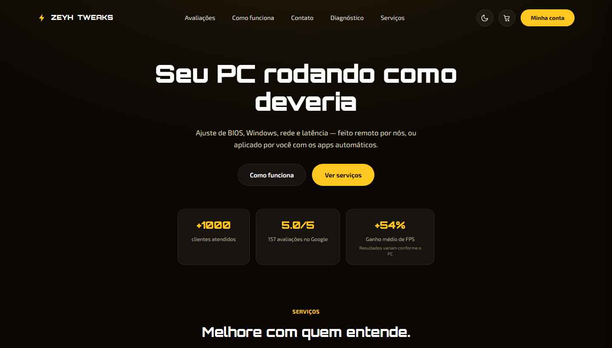
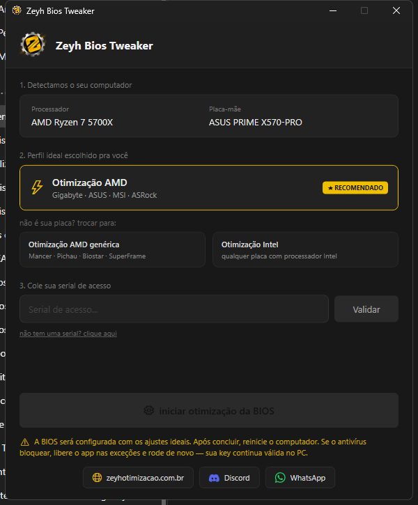
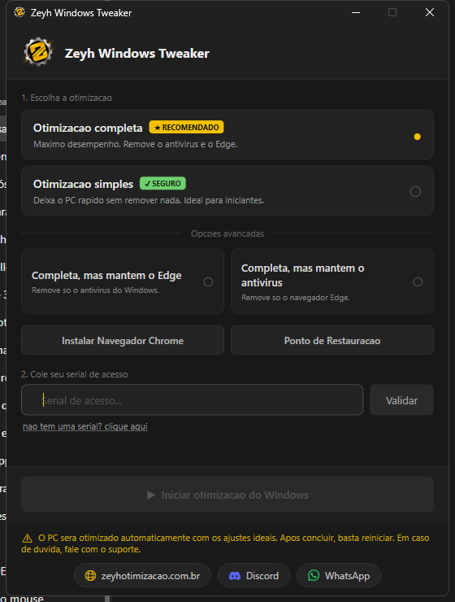

# Richard Ruan Gonçalves

**Suporte de TI · Redes e infraestrutura · Otimização de Windows**

Sou profissional de TI em Jaraguá do Sul, SC, com experiência em suporte técnico N3, atendimento presencial e remoto, manutenção de computadores e diagnóstico de problemas de hardware, software e conectividade. Atualmente, estudo Segurança da Informação.

[LinkedIn](https://www.linkedin.com/in/richardgon%C3%A7alves/) · [Zeyh Tweaks](https://zeyhotimizacao.com.br/)

## Produtos

Produtos da Zeyh Tweaks, o meu serviço de otimização de PC para jogos. Código fechado.

### Site Zeyh Tweaks — [zeyhotimizacao.com.br](https://zeyhotimizacao.com.br/)

Site e sistema do serviço, feitos por mim do zero, front-end e back-end. Só o pagamento é do Mercado Pago, integrado ao sistema.

- **Front-end:** HTML, CSS e JavaScript — serviços, diagnóstico que indica o serviço certo para o PC, agendamento, checkout e área do cliente.
- **Back-end:** Node.js com Express e MySQL — pedidos, agenda, notificações (web push) e proteções como Helmet e limite de requisições.
- **Integrações:** bots de Discord e WhatsApp para atendimento e avisos de pedido, e pagamento pelo Mercado Pago.
- Mais de 1000 clientes atendidos e nota 5.0 no Google.

### Zeyh BIOS Tweaker

App para Windows (WPF / .NET) que otimiza a BIOS para jogos. Detecta o processador e a placa-mãe, indica o perfil certo (AMD, AMD genérico ou Intel) e configura a BIOS com os ajustes; o acesso é por chave. · [conhecer](https://zeyhotimizacao.com.br/)

### Zeyh Windows Tweaker

App para Windows (WPF / .NET) que otimiza o Windows para jogos, com perfis: completo (remove o Edge e o antivírus do Windows para o máximo desempenho), simples (não remove nada) e intermediários, que mantêm o Edge ou o antivírus. Também cria ponto de restauração antes; o acesso é por chave. · [conhecer](https://zeyhotimizacao.com.br/)

## Projetos em código aberto

Ferramentas que criei para resolver problemas reais de hardware e rede.

| Projeto | O que é | Feito com |
|---|---|---|
| **[Zeyh DRAM Tweaker](https://github.com/zeyhcrazy/ZeyhDramTweaker)** | Calculadora de timings e tensões de RAM para Ryzen (Zen 1 a Zen 5). Lê a memória do PC, compara com o recomendado e mede a latência em ns. | C# · WPF · .NET 9 |
| **[LG webOS TV — tela inicial própria](https://github.com/zeyhcrazy/lg-webos-home)** | TV LG (webOS 6) deixada limpa e com tela inicial estilo PS5, com relato técnico do processo de personalização e root (feito pelo método público da comunidade). | webOS · Linux · HTML/JS · Python |
| **[Casa-Controle](https://github.com/zeyhcrazy/Casa-Controle)** | App Android que liga e desliga o PC (Wake-on-LAN) e controla a TV LG pela rede local, com certificado fixado e pareamento por token. | Android · Java · Python |
| **[iRok ND68 — firmware USB](https://github.com/zeyhcrazy/irok-nd68)** | Engenharia reversa do firmware de um teclado para corrigir falha de enumeração USB em placas X570. | Reverse engineering · Firmware · C# · PowerShell |

## Tecnologias

## Áreas de atuação

- **Suporte técnico:** atendimento a usuários, diagnóstico de incidentes e acompanhamento de chamados.
- **Redes e infraestrutura:** configuração de roteadores, conectividade, instalação e manutenção de equipamentos.
- **Windows e hardware:** otimização de sistemas, ajustes de BIOS e drivers, análise de desempenho e estabilidade.
- **Automação:** criação e uso de scripts para padronizar ajustes e agilizar rotinas técnicas.

## Experiência na prática

Na **Zeyh Otimização / Zeyh Tweaks**, atuo com otimização de PCs e atendimento remoto, com foco em desempenho, estabilidade e baixa latência.

Minha trajetória também inclui suporte em campo na **Wyntech**, atendendo unidades da Caixa e casas lotéricas, além de suporte a usuários na **VIG Informática** e atendimento de redes e internet na **Athena Telecomunicação**.

## Formação e desenvolvimento

- Segurança da Informação — em andamento.
- Trilha Profissionalizante do Analista de Cibersegurança Júnior — Cisco Networking Academy.
- Introdução à Cibersegurança — Cisco Networking Academy.

## Contato profissional

Tenho interesse em oportunidades de **suporte técnico, infraestrutura de TI e cibersegurança júnior**, em Jaraguá do Sul e região ou com atuação remota.

Para conversar sobre oportunidades ou projetos, entre em contato pelo [LinkedIn](https://www.linkedin.com/in/richardgon%C3%A7alves/). Para conhecer meu trabalho com otimização de PCs, acesse o [site da Zeyh Tweaks](https://zeyhotimizacao.com.br/).
